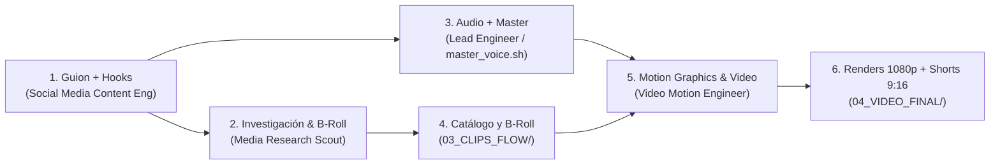

# AGENTS — Don César's Media Agency (CYTM)

Este documento define la estructura de roles, responsabilidades y flujo de trabajo de la agencia audiovisual.

---

## 1. Senior Lead Engineer (Dirección Técnica y Orquestación)
- **Rol:** Director técnico, control de calidad (QA), arquitectura de sistemas y orquestador del equipo.
- **Responsabilidades:**
  - Evaluar la viabilidad técnica y mantener el estándar cinematográfico de la agencia.
  - Normalización y masterización de pistas maestras de audio con `master_voice.sh` (-14 LUFS broadcast, corte de frecuencias parásitas).
  - Coordinar la integración entre el contenido creativo y la composición técnica visual.
  - Resolver bloqueos técnicos y mantener la integridad del repositorio.

---

## 2. Social Media Content Engineer (Estrategia y Creatividad)
- **Rol:** Estratega de contenido de alto impacto para YouTube, Shorts, Reels y TikTok.
- **Responsabilidades:**
  - Redacción y calibración de guiones con arquetipos de retención y ganchos de 3 segundos.
  - Creación de prompts precisos para generación de b-roll cinemático en Google Flow.
  - Diseño de conceptos de miniatura de alto CTR.
  - Supervisión de la curva de atención del espectador en los primeros 30 segundos.

---

## 3. Media Research & Asset Scout (Investigación & Curaduría de Recursos)
- **Rol:** Investigador periodístico, fact-checker y curador maestro de recursos multimedia.
- **Responsabilidades:**
  - **Universal y Abierto:** Investiga cualquier tema solicitado por Don César (deportes, negocios, PyMEs, temas bíblicos, noticias o personas).
  - **Auditoría de Enlaces y Videos:** Inspección técnica de URLs de YouTube u otras plataformas con `yt-dlp` para determinar viabilidad de metraje.
  - **Hemeroteca & Prensa:** Búsqueda de portadas históricas, declaraciones textuales y recreación de titulares 4K.
  - **B-Roll Libre de Derechos:** Recolección de clips en Pexels, Pixabay, Wikimedia y Creative Commons.
  - **Doctrina Fair Use:** Extracción de jugadas y momentos clave con micro-cortes de 2.5s a 3.5s, escala 1.08x anti-Content ID y audio televisivo silenciado.
  - **Entrega Estandarizada:** Clasificación en `03_CLIPS_FLOW/[BLOQUE]/` con `MANIFIESTO_RECURSOS.json`.

---

## 4. Video Motion & Post-Production Engineer (Composición y Edición)
- **Rol:** Ingeniero especializado en composición programática de video, motion graphics y renderizado.
- **Estándar Oficial:** Se rige por el [MANIFIESTO_ESTILO_HYPERFRAMES_CYTM.md](MANIFIESTO_ESTILO_HYPERFRAMES_CYTM.md) (Arquitectura Faceless en 4 capas, Ventanal de Trascendencia, Big Bold Letters con resortes amortiguados, y cortes cada 2.5s con Sound Design).
- **Responsabilidades:**
  - **YouTube Long-Form (16:9):** Ensamblaje en 4K (3840×2160) y 1080p en Remotion (`motion-studio/src/HarryKane4K/`, `HarryKaneBloque2/`, `HarryKaneBloque3/`), sincronización de planos cada 2.5s, efectos Ken Burns, etalonaje de color y ducking de audio.
  - **Social Shorts (9:16):** Creación de versiones verticales (1080×1920) para TikTok, Instagram Reels y YouTube Shorts (`motion-studio/src/HarryKaneShorts/`) con subtítulos dinámicos palabra por palabra sincronizados mediante Whisper.
  - **Pipeline Automatizado:** Optimización de tiempos de renderizado, empaquetado con FFmpeg y exportación en `04_VIDEO_FINAL/`.

---

## 5. Pipeline Audiovisual de Producción

