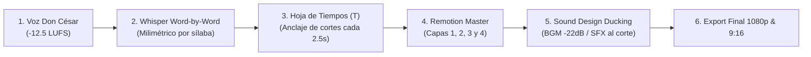

# ⚡ MANIFIESTO DE ESTILO AUDIOVISUAL: HYPERFRAMES & CODE-DRIVEN ANIMATION
**Don César's Media Agency (CYTM) · Ingeniería Audiovisual Faceless de Alto Impacto**
*Referencia de Estudio: Video-Pipeline Programático (Guney Topcu / HyperFrames) adaptado a Documental Deportivo*

---

## 1. La Filosofía: Animación por Código vs. Videos IA Tradicionales

La razón por la que canales como el de Guney Topcu o Josema atrapan al espectador de principio a fin **no es la inteligencia artificial generativa de video clásica** (como Runway o Sora, que deforman caras y cambian de estilo cada 4 segundos), sino la **Animación Programática Basada en Código (HyperFrames / Remotion)**:

| Característica | Video IA Tradicional (Runway, Sora, Kling) | Animación por Código (HyperFrames / Remotion en CYTM) |
| :--- | :--- | :--- |
| **Consistencia Visual** | ❌ Pésima. El personaje o sujeto cambia de cara, ropa y estilo. | ✅ **100% Determinista.** Cada píxel, color, tipografía y logo es idéntico en cada frame. |
| **Sincronización Fonética** | ❌ Imposible. El video se genera en bloque sin saber qué palabra suena. | ✅ **Milimétrica al fotograma.** La palabra "DESPEDIDO" aparece exactamente en el frame 1010. |
| **Costo y Rendimiento** | ❌ Carísimo (créditos por segundo, cientos de dólares). | ✅ **Gratis y local.** Se compila en la GPU/CPU de su propia Mac en minutos. |
| **Retención del Espectador** | ⚠️ Baja. Movimientos lentos y borrosos tipo "sueño". | 🚀 **Máxima (Dopamina pura).** Patrón de interrupción cada 2.5s con gráficos táctiles. |

---

## 2. Anatomía de un Fotograma Maestro (Composición en 4 Capas)

En los videos convencionales, el creador se sienta a hablar frente a la cámara. En el canal de Don César, **la producción es 100% Faceless** (sin salir a cámara). El espacio del presentador se convierte en el **"Ventanal de Trascendencia"**.

```
+-----------------------------------------------------------------------------------+
|  CAPA 4: HUD & SUBTÍTULOS WHISPER (KARAOKE DINÁMICO PALABRA POR PALABRA)          |
|  [ Telemetría CYTM ]                     [ "EL UNIVERSO ME ODIA" - Resaltado ]    |
|-----------------------------------------------------------------------------------|
|  CAPA 3: EL SUJETO / VENTANAL DE TRASCENDENCIA (DELANTE DEL TÍTULO)               |
|                                         +-------------------------------------+   |
|                                         |  Corte de Jugada Fair Use (3.0s)   |   |
|                                         |  o Cutout PNG de Kane Arrodillado   |   |
|                                         |  con Sombra Profunda y Borde Luz    |   |
|                                         +-------------------------------------+   |
|  CAPA 2: TITULARES GIGANTES CINÉTICOS (BEHIND-THE-SUBJECT TYPOGRAPHY)             |
|   S E I S   F I N A L E S .   S E I S   D E R R O T A S .                         |
|   (Tipografía brutalista que llena el 75% del ancho, en capas detrás del sujeto)  |
|-----------------------------------------------------------------------------------|
|  CAPA 1: FONDO ATMOSFÉRICO CINEMATOGRÁFICO                                       |
|  Gradiente Noir (#06070B) + Focos Nocturnos con Desenfoque + Grano Fílmico (5%)    |
+-----------------------------------------------------------------------------------+
```

---

## 3. Desglose de Elementos Clave que Atrapan la Atención

### A. Tipografía Cinética Gigante ("Big Bold Letters")
- **Tamaño Heroico:** La palabra clave de la frase no se coloca en un subtítulo diminuto; se estampa en pantalla con un tamaño de entre **70px y 96px** en 4K (ocupando el 60% al 85% del ancho del fotograma).
- **Entrada Orgánica (No robótica):**
  - Entran con resortes amortiguados (`damping: 18, mass: 0.9`), jamás con un fade lineal aburrido.
  - Al aterrizar, el texto **se queda congelado e inmóvil**, permitiendo que el ojo lo lea con facilidad mientras el movimiento continúa en el fondo o en el video.
- **Jerarquía Cromática de Alto Contraste:**
  - Texto principal: Blanco Puro (`#FFFFFF`) o Platino (`#E6E6FA`).
  - Palabra de Tensión / Dolor: Rojo Carmesí (`#FF0033` o `#FF3B30`).
  - Palabra de Victoria / Gloria: Oro Real (`#FFD700`).
  - Dato Tecnológico / Telemetría: Cian Neón (`#00E5FF`).

### B. El "Ventanal de Trascendencia" (Sustituyendo la Cara del Creador)
Don César no necesita grabarse. Su voz barítona oficial ya proyecta autoridad broadcast. El espacio donde otros ponen su cara lo resolvemos con tres tipos de contenido que rotan dinámicamente:
1. **Micro-Cortes Fair Use (2.5s a 3.5s):** Jugadas reales con escala 1.08x, corrección de color cinemática (contraste +1.2, desaturación sutil -10%) y audio de TV silenciado.
2. **Cutouts PNG en Profundidad 3D:** Recortes transparentes de Kane (festejando, arrodillado, en el banquillo) colocados superpuestos sobre los números o títulos, creando un efecto de profundidad multicapa (*sandwiching*).
3. **Tarjetas de Prensa 4K (Tabloides Reconstruidos):** Portadas de *The Telegraph*, *BILD*, *Daily Mail* o *The Guardian* con sombra paralela profunda de 80px que flotan en el centro de la pantalla.

### C. Patrón de Interrupción Continuo (Regla de los 3 Segundos)
El cerebro humano desconecta cuando una imagen dura más de 4 segundos sin cambios. La fórmula aplica:
- **Corte de plano visual cada 2.5 a 3.5 segundos.**
- **Movimiento constante pero sutil (Ken Burns):** Un micro-zoom del `1.0` al `1.08` en el plano general mientras la voz habla.
- **Foley & Sound Design en cada corte:**
  - Cambio de tema: `whoosh.mp3` o `barrido.mp3` (0.4s).
  - Revelación dolorosa o sentencia: `impact-bass-1.mp3` + `golpe.mp3` a -10 dB.
  - Tensión previa a un clímax: `riser.mp3`.
  - Fracaso o ruptura de expectativas: `glitch-1.mp3`.

---

## 4. Guía Maestra para el Agente Editor de Video (`video-motion-engineer`)

Esta es la especificación técnica obligatoria que el Agente Editor debe ejecutar en cada bloque y entrega:



### Reglas Técnicas Inquebrantables de Edición:
1. **Prohibido el estatismo:** Ningún fotograma puede carecer de movimiento. Si la imagen es fija, lleva un slow push-in; si es video, lleva corrección de color y letterbox cinemático.
2. **Sincronía de Letras Grandes:** La palabra grande en pantalla debe aparecer en el milisegundo exacto en que la voz pronuncia su primera sílaba (obtenido directamente de `words.json`).
3. **Doble Entrega Siempre:**
   - **Formato YouTube (16:9 1080p / 4K):** Ensamble horizontal monumental, panorámico, con títulos grandes en el lateral izquierdo y el Ventanal de Trascendencia a la derecha.
   - **Formato Vertical (9:16 1080×1920):** Reencuadre vertical dinámico con subtítulos al centro en tipografía móvil (*Cyber Cyan* o *Gold*), ideal para TikTok, Shorts y Reels.
4. **Acabado Broadcast Film Look:** Toda composición debe incluir la viñeta perimetral de contraste, el grano analógico ligero (0.04-0.05) y las barras cinemáticas letterbox 2.39:1 en formato horizontal.
